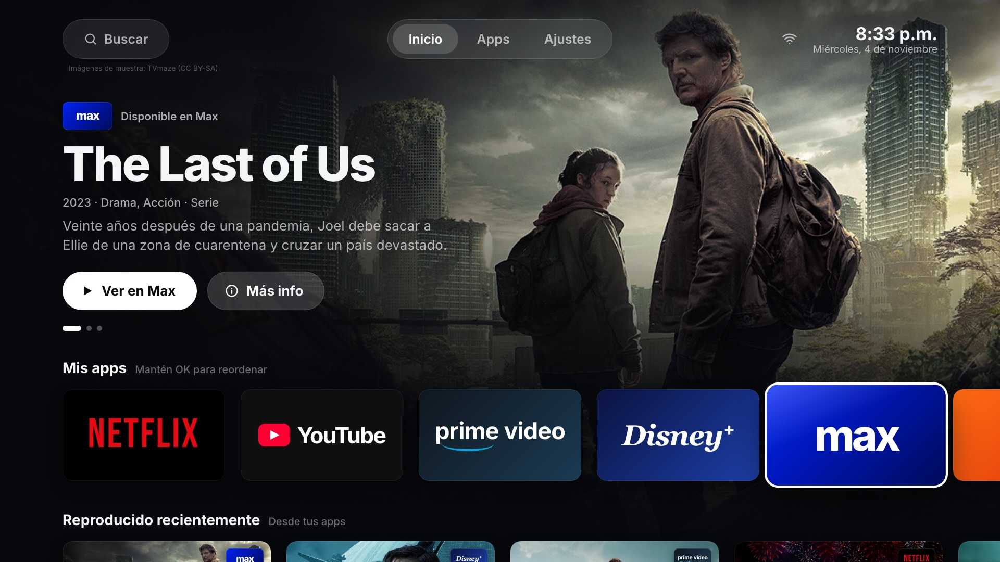
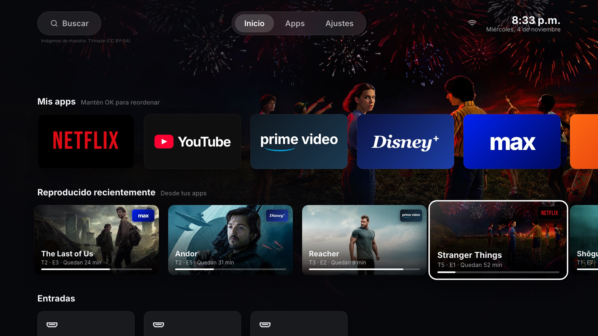
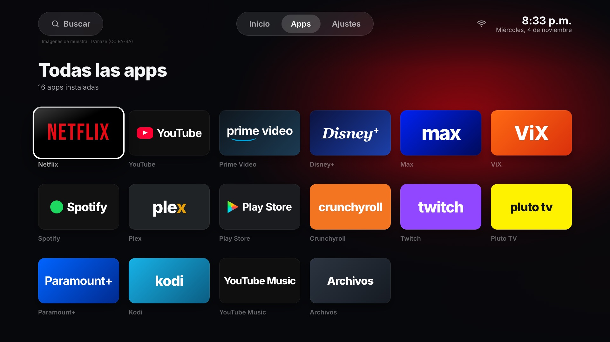
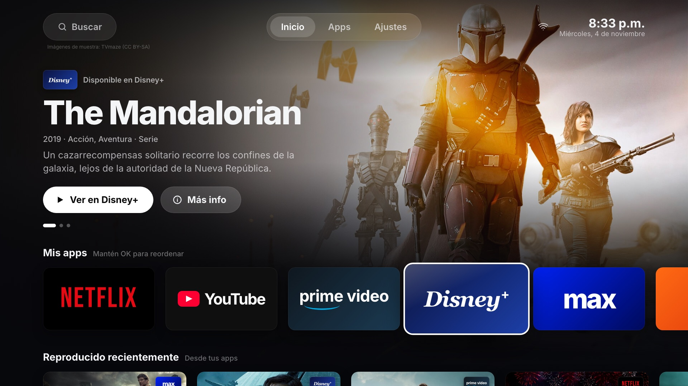
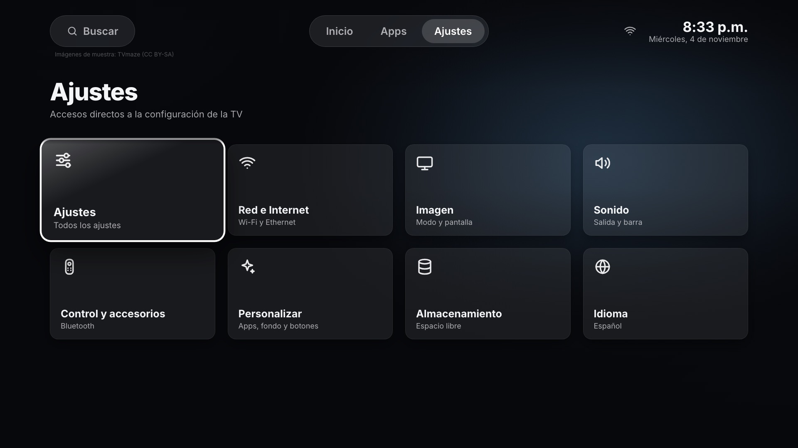

# hack_tv

[English](README.md) · **Español**

Launcher personalizado para Android TV: pantalla de inicio sin anuncios, remapeo de los botones del control y recomendaciones de streaming. Hecho con Kotlin y Compose for TV.

Empezó como una forma de acelerar y limpiar una TV Hisense con Android TV (Android 12, MediaTek MT9689, 2.4 GB de RAM) sin comprar apps de terceros.

**[▶ Prueba la maqueta interactiva](https://diegopq.github.io/hack_tv/?lang=es)** ([Español](https://diegopq.github.io/hack_tv/?lang=es) · [English](https://diegopq.github.io/hack_tv/?lang=en)): usa el teclado como control remoto, o haz clic o toca la pantalla.



| Reproducido recientemente | Todas las apps |
|---|---|
|  |  |
| **Las recomendaciones siguen a la app enfocada** | **Accesos directos a los ajustes** |
|  |  |

> Las capturas son de la maqueta HTML, todavía no de la app Android. La interfaz está disponible en español e inglés.

## Contenido

- [Estado](#estado)
- [Funciones planeadas](#funciones-planeadas)
- [Maqueta del diseño](#maqueta-del-diseño)
  - [Idiomas](#idiomas)
  - [Parámetros de la URL](#parámetros-de-la-url)
- [Compilar e instalar el launcher](#compilar-e-instalar-el-launcher)
- [Configuración](#configuración)
- [Activar la depuración por red en tu TV](#activar-la-depuración-por-red-en-tu-tv)
  - [Deja que un agente de IA te guíe](#deja-que-un-agente-de-ia-te-guíe)
- [Optimiza tu TV con un agente de IA](#optimiza-tu-tv-con-un-agente-de-ia)
- [Revertir las optimizaciones de la TV](#revertir-las-optimizaciones-de-la-tv)
- [Créditos](#créditos)
- [Licencia](#licencia)

## Estado

| Parte | Estado |
|---|---|
| Diseño de la interfaz (maqueta HTML) | ✅ Listo: [`diseno/maqueta.html`](diseno/maqueta.html) |
| Script para revertir las optimizaciones de la TV | ✅ Listo: [`revert_tv.sh`](revert_tv.sh) |
| App launcher para Android | 🚧 v0.1 en [`launcher/`](launcher/): Inicio con el banner (datos de muestra), tus apps, entradas HDMI y accesos a ajustes, las páginas Todas las apps y Ajustes, en español e inglés |

## Funciones planeadas

- **Pantalla de inicio sin anuncios** con tus apps, las entradas HDMI y accesos directos del sistema.
- **Banner de recomendaciones** con películas y series disponibles en las apps de streaming que tienes instaladas, desde [TMDB](https://www.themoviedb.org/). Se filtra según la app que tengas enfocada.
- **Fila de reproducido recientemente**, armada con el historial local propio del launcher a partir de lo que reproducen tus apps (sesiones multimedia de Android).
- **Remapeo de botones del control** mediante un servicio de accesibilidad, por ejemplo los botones de Ajustes, Lista de apps, YouTube, Prime Video y Disney+.
- **Ligero**: optimizado para TVs con hardware modesto.

## Maqueta del diseño

Pruébala en línea en **[diegopq.github.io/hack_tv](https://diegopq.github.io/hack_tv/?lang=es)**, o abre [`diseno/maqueta.html`](diseno/maqueta.html) localmente en un navegador. Se dibuja a 1920×1080 y se escala para caber en la ventana. Cada cambio que se sube a `diseno/` se vuelve a publicar con [GitHub Pages](.github/workflows/pages.yml).

Usa el teclado como control remoto:

| Tecla | Acción |
|---|---|
| Flechas | Navegar |
| Enter | Abrir |
| Esc | Volver al inicio |
| ← → en los botones del banner | Recomendación anterior o siguiente |
| A / S | Simula los botones de Lista de apps y Ajustes del control |
| N / Y / P / D | Simula los botones de Netflix, YouTube, Prime Video y Disney+ |
| L | Cambiar idioma (español / inglés) |
| H | Mostrar u ocultar la barra de ayuda |
| Clic o toque | Enfoca un elemento; otro clic lo abre |

### Idiomas

La maqueta está en español e inglés. Elige el idioma en este orden:

1. El parámetro `?lang=es` o `?lang=en` de la URL.
2. El último idioma que elegiste con **L** o con la tarjeta **Idioma** en Ajustes. Se guarda en tu navegador.
3. El idioma de tu navegador; si no es español ni inglés, usa inglés.

Todos los textos de la interfaz están en el diccionario `I18N` de [`diseno/maqueta.html`](diseno/maqueta.html). Para agregar un idioma, copia el bloque `en`, tradúcelo y agrega las traducciones a los campos `{es:…, en:…}` de los datos de muestra. La app Android usará en su lugar los recursos de texto estándar de Android y pedirá los datos de TMDB en el idioma de la TV.

### Parámetros de la URL

Los parámetros de la URL definen un estado inicial, útil para demos y capturas: `?lang=es`, `?app=max`, `?focus=recent&recent=2`, `?focus=hero`, `?view=apps`, `?view=settings`, `?hint=0`, `?autoplay=0`, `?still=1` (apaga las animaciones).

Las imágenes de muestra vienen de [TVmaze](https://www.tvmaze.com/) (CC BY-SA) y se cargan desde sus servidores.

## Compilar e instalar el launcher

La app está en [`launcher/`](launcher/): Kotlin y Compose for TV, para Android 12 (API 31) o superior. Necesitas un JDK 17 o superior (sirve el que trae Android Studio) y el SDK de Android con la plataforma 36.

```bash
cd launcher
./gradlew assembleRelease          # genera app/build/outputs/apk/release/app-release.apk (unos 2 MB)
adb connect <TV_IP>:5555
adb install -r app/build/outputs/apk/release/app-release.apk
```

Ábrela desde la lista de apps de la TV (**hack_tv**). También queda registrada como app de inicio, pero en Google TV el launcher original conserva el botón Inicio hasta que se desactiva. No lo desactives todavía: en las TVs Hisense los botones de acceso directo del control dependen de él hasta que esté listo el mapeo de botones propio del launcher.

Las versiones release se firman con tu clave local de depuración para poder instalarlas por adb. Configura una clave de firma real antes de publicar un APK.

## Configuración

Los ajustes locales y las claves de API van en un archivo `.env` que Git ignora:

```bash
cp .env.example .env
```

| Variable | Descripción |
|---|---|
| `TV_IP` | Dirección IP de tu TV en la red local |
| `TV_PORT` | Puerto de adb (por defecto `5555`) |
| `TMDB_API_KEY` | Clave de API gratuita de TMDB para las recomendaciones ([consíguela aquí](https://www.themoviedb.org/settings/api)) |

Nunca subas `.env` al repositorio. Solo `.env.example` va en el repositorio.

## Activar la depuración por red en tu TV

`adb` permite que tu computadora, o un agente de IA que corra en ella, controle la TV por Wi-Fi. Los nombres de los menús cambian un poco según la marca y la versión de Android TV.

1. **Activa las Opciones para desarrolladores.** Ve a **Configuración → Sistema → Información** (en Android TV más antiguo: **Configuración → Preferencias del dispositivo → Información**). Selecciona **Compilación del SO de Android TV** (o **Compilación**) 7 veces, hasta que aparezca "Ahora eres desarrollador".
2. **Activa la depuración.** Regresa a **Configuración → Sistema → Opciones para desarrolladores** y activa **Depuración por USB**. Si también ves **Depuración por red** o **ADB por red**, actívala.
3. **Busca la IP de la TV.** Ve a **Configuración → Red e Internet** y selecciona tu red Wi-Fi. Anota la IP, por ejemplo `192.168.1.50`, y ponla en `TV_IP` en tu `.env`.
4. **Instala adb en tu computadora.** Descarga [Android platform-tools](https://developer.android.com/tools/releases/platform-tools), o en macOS ejecuta `brew install android-platform-tools`.
5. **Conéctate.** La TV y la computadora deben estar en la misma red:

   ```bash
   adb connect 192.168.1.50:5555
   ```

6. **Acepta el aviso en la TV.** La TV pregunta *"¿Permitir la depuración por USB?"*. Marca **Permitir siempre desde esta computadora** y elige **Aceptar**. Comprueba que funcionó:

   ```bash
   adb devices   # la TV debe aparecer como "device", no como "unauthorized"
   ```

**Si `connect` falla:** algunas TVs usan **Depuración inalámbrica** con un código de vinculación. Ábrela en Opciones para desarrolladores, elige **Vincular dispositivo con código de vinculación**, ejecuta `adb pair <IP>:<puerto de vinculación>` y escribe el código. Después ejecuta `adb connect <IP>:<puerto>` con el puerto que muestra esa pantalla.

**Seguridad:** solo se pueden conectar las computadoras que apruebes en la TV, pero desactiva la **Depuración por USB** cuando termines de hacer ajustes, sobre todo en una red compartida.

### Deja que un agente de IA te guíe

Si prefieres que te acompañen paso a paso, pega este prompt en un agente de IA que pueda ejecutar comandos en tu computadora, como [Claude Code](https://claude.com/claude-code). El agente no puede presionar botones en la TV, así que te dice qué seleccionar y revisa cada paso desde la computadora:

```text
Ayúdame a activar la depuración por red de adb en mi Android TV para que esta computadora pueda conectarse por Wi-Fi. Guíame un paso a la vez y espera a que confirme cada paso antes de seguir. Estoy usando el control remoto de la TV, así que dime exactamente qué menús y opciones seleccionar, y ten en cuenta que los nombres de los menús cambian según la marca y la versión de Android TV (Google TV o Android TV más antiguo).

1. Revisa primero esta computadora: ¿está instalado adb (Android platform-tools)? Si no, dime cómo instalarlo en mi sistema operativo y compruébalo con "adb version".
2. Guíame para activar las Opciones para desarrolladores en la TV (seleccionar 7 veces el número de compilación en Información).
3. Guíame para activar la Depuración por USB y, si la TV la tiene, la Depuración por red / ADB por red o la Depuración inalámbrica.
4. Ayúdame a encontrar la IP de la TV en su configuración de red. Si no la encuentro, puedes buscar dispositivos en mi propia red local con el puerto 5555 abierto, pero dime antes qué vas a ejecutar.
5. Conéctate con "adb connect <IP>:5555". Si la TV usa Depuración inalámbrica con código de vinculación, guíame primero con "adb pair".
6. Recuérdame aceptar en la TV el aviso "¿Permitir la depuración por USB?" y marcar "Permitir siempre desde esta computadora". Después ejecuta "adb devices" y confirma que la TV aparece como "device".
7. Si algo falla ("unauthorized", "connection refused", tiempos de espera agotados), explícame la causa probable y cómo arreglarlo. Antes que nada, prueba reiniciar el servidor de adb.
8. Cuando funcione, guarda la IP como TV_IP en un archivo .env en esta carpeta (créalo a partir de .env.example si existe), ejecuta "adb shell getprop ro.product.model" para mostrarme el modelo de la TV y recuérdame desactivar la Depuración por USB cuando termine.

Todavía no cambies ningún ajuste de la TV por adb; esta tarea es solo para lograr la conexión.
```

## Optimiza tu TV con un agente de IA

Puedes dejarle la limpieza a un agente de IA que pueda ejecutar comandos en tu computadora, como [Claude Code](https://claude.com/claude-code). Primero activa la depuración por red (sección anterior), luego pega este prompt y cambia `<TV_IP>` por la IP de tu TV:

```text
Quiero acelerar mi Android TV y quitar lo que no uso. Está en mi red local con la depuración por red de adb activada en <TV_IP>:5555. Usa adb desde esta computadora; si no está instalado, primero dime cómo instalarlo.

1. Conéctate y analiza
   - Conéctate con adb y confirma que la TV aparece como "device". Si aparece como "unauthorized", pídeme que acepte el aviso en la TV.
   - Dime el modelo, la versión de Android, el procesador, la RAM, el almacenamiento libre y qué está usando más memoria y CPU (dumpsys meminfo, top, load average).
   - Lista los paquetes instalados y agrúpalos: esenciales del sistema, extras del fabricante, apps preinstaladas y apps que yo instalé.

2. Propón un plan antes de cambiar nada
   - Por cada paquete que quieras desactivar, explica en palabras sencillas qué hace y qué podría dejar de funcionar. Pídeme confirmar cada grupo y pregúntame qué apps y funciones uso de verdad (transmitir desde el celular/AirPlay, asistente de voz, sintonizador de TV abierta, tienda del fabricante, protector de pantalla, etc.).
   - Propón también ajustes de rendimiento: animaciones más cortas (window_animation_scale, transition_animation_scale, animator_duration_scale) y un límite menor de procesos en segundo plano (device_config activity_manager max_cached_processes).
   - No cambies nada hasta que yo lo apruebe.

3. Aplica los cambios con cuidado
   - Usa solo comandos reversibles: "pm disable-user --user 0 <paquete>" y "settings put". Nunca desinstales paquetes del sistema, nunca borres datos de apps y nunca toques Play Store, Google Play services, la interfaz del sistema, los métodos de entrada ni los servicios de entradas/sintonizador de la TV, salvo que yo te lo pida.
   - Antes de desactivar algo, escribe un script para revertir (revert_tv.sh) que reactive cada paquete que desactives y restaure los ajustes originales, y muéstramelo.
   - Los cambios de paquetes se guardan en disco con retraso: espera unos 30 segundos después del último cambio antes de reiniciar.
   - Desactiva en grupos pequeños. Después de cada grupo, reinicia y prueba conmigo: la pantalla de inicio, cada botón del control (Inicio, Atrás, Ajustes, botones de acceso directo a apps, volumen), las entradas HDMI, el sonido y mis apps de streaming.

4. Cosas que suelen romperse (aprendido en una TV Hisense con Android TV)
   - Los botones de acceso directo del control (Ajustes, Lista de apps, YouTube, Prime Video, Disney+) muchas veces los maneja el launcher original o un servicio del fabricante (en Hisense, com.vt.tv.smartsense). Prueba los botones después de desactivar paquetes del launcher o del fabricante, y reactiva lo necesario.
   - Desactivar el launcher original (Google TV: com.google.android.apps.tv.launcherx) puede dejar como pantalla de inicio una pantalla de recuperación del asistente de configuración (com.google.android.tungsten.setupwraith). No desactives el launcher original hasta que haya otro launcher instalado y configurado como inicio.
   - El retraso del volumen con una barra de sonido por HDMI-CEC/ARC viene de la barra, no de la TV; no intentes arreglarlo desactivando paquetes.

5. Instala el launcher hack_tv
   - Revisa https://github.com/diegopq/hack_tv/releases para ver si hay un APK. Si todavía no hay una versión publicada, detente aquí y dímelo.
   - Si la hay, descárgala, instálala con "adb install", configúrala como app de inicio y guíame en la pantalla de la TV para dar los permisos que necesita (servicio de accesibilidad para los botones del control, acceso a notificaciones para "Reproducido recientemente", acceso a datos de uso). No escribas contraseñas ni cuentas por mí.
   - Prueba conmigo la pantalla de inicio y los botones del control, y agrega cualquier cambio nuevo al script para revertir.

Al final, dame un resumen: qué cambiaste, cuánta memoria libre hay comparado con antes y cómo deshacer todo con el script para revertir.
```

El prompt le pide al agente confirmar antes de cada cambio y que todo sea reversible. Lee cada paso que te proponga antes de aprobarlo.

## Revertir las optimizaciones de la TV

Las optimizaciones desactivan algunos paquetes preinstalados (extras de Hisense, AirPlay, el protector de pantalla ambiental de Google) y aceleran las animaciones. Para deshacerlas, ejecuta esto con la depuración por red activada en la TV y `TV_IP` configurada en `.env`:

```bash
./revert_tv.sh               # reactiva todo
./revert_tv.sh com.vt.alexa  # reactiva un solo paquete
```

Necesitas [Android platform-tools](https://developer.android.com/tools/releases/platform-tools) (`adb`). El script lo busca en `~/Library/Android/sdk/platform-tools/adb`. Define `ADB` para usar otra ubicación.

## Créditos

- Datos de recomendaciones: [TMDB](https://www.themoviedb.org/). Este producto usa la API de TMDB, pero no está avalado ni certificado por TMDB.
- Imágenes de muestra de la maqueta: [TVmaze](https://www.tvmaze.com/).
- Los nombres y logos de las apps pertenecen a sus respectivos dueños. No se incluyen en este repositorio; el launcher usa el banner propio de cada app instalada.

## Licencia

[Apache License 2.0](LICENSE)
