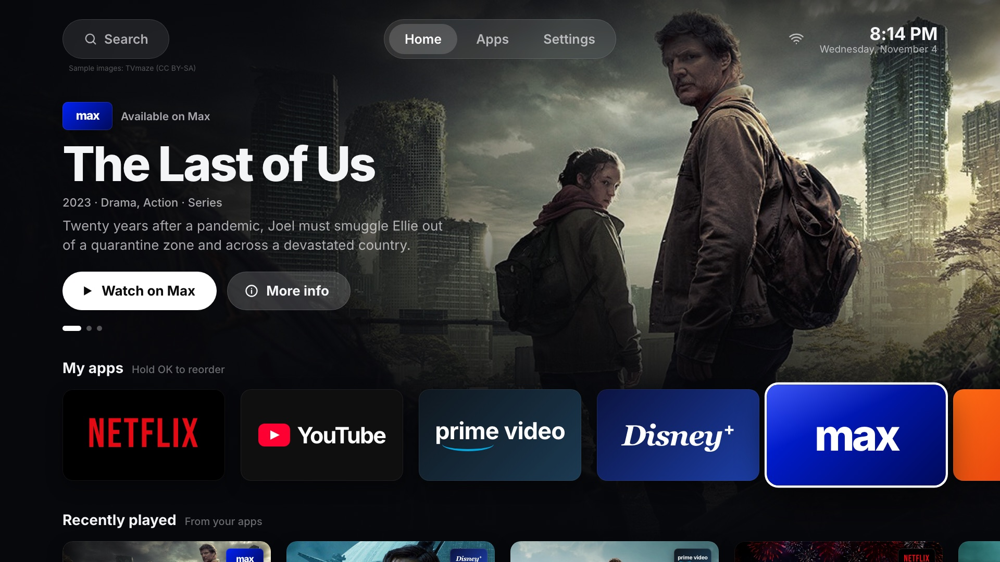
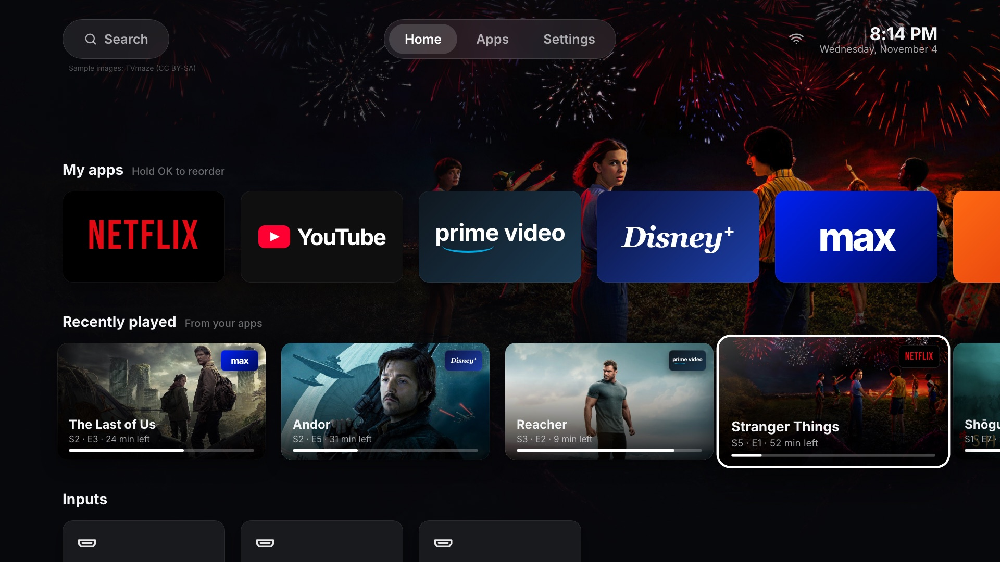
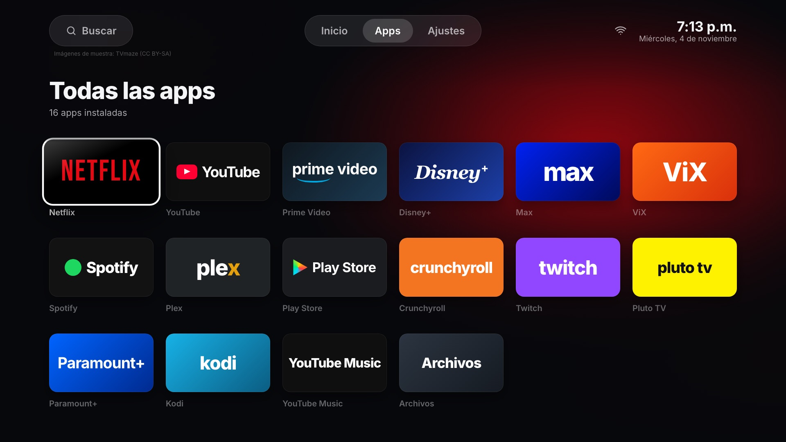
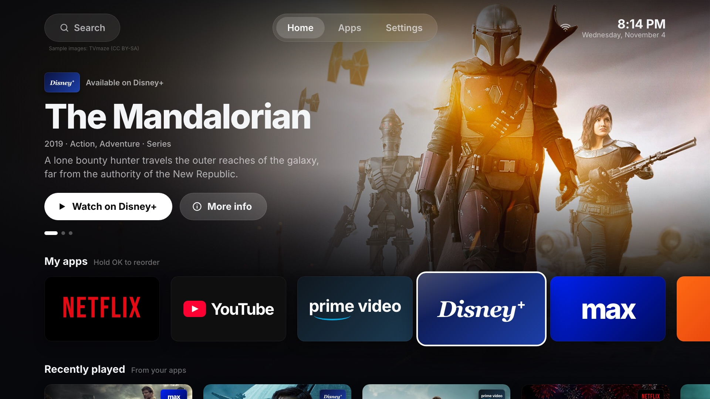
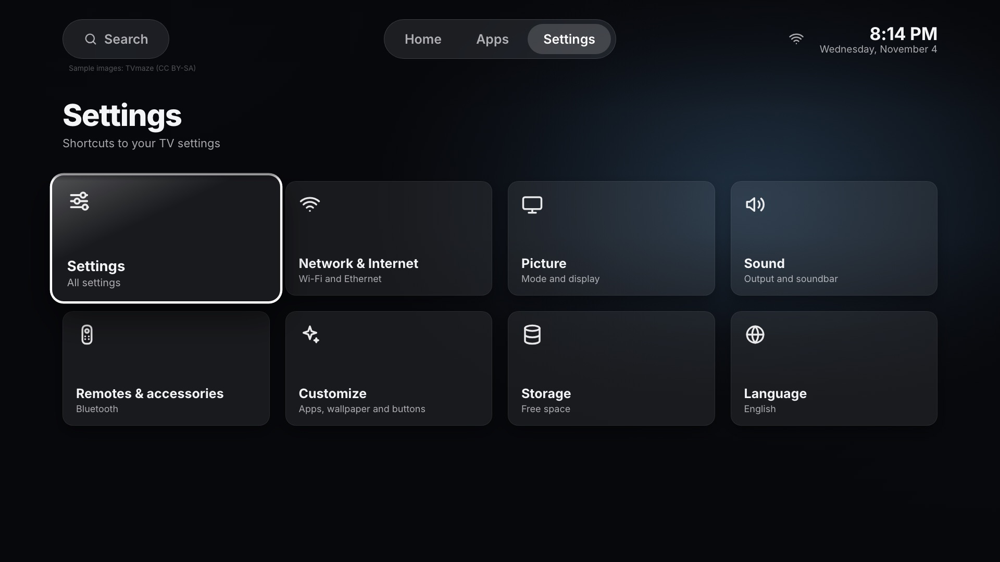

# hack_tv

**English** · [Español](README.es.md)

Custom Android TV launcher: ad-free home screen, remote button remapping, and streaming recommendations. Built with Kotlin and Compose for TV.

It started as a way to speed up and clean up a Hisense Android TV (Android 12, MediaTek MT9689, 2.4 GB RAM) without buying third-party apps.

**[▶ Try the interactive mockup](https://diegopq.github.io/hack_tv/)** ([English](https://diegopq.github.io/hack_tv/?lang=en) · [Español](https://diegopq.github.io/hack_tv/?lang=es)): use your keyboard as the remote, or click and tap.



| Recently played | All apps |
|---|---|
|  |  |
| **Recommendations follow the focused app** | **Settings shortcuts** |
|  |  |

> Screenshots come from the HTML mockup, not the Android app yet. The UI is available in English and Spanish.

## Contents

- [Status](#status)
- [Planned features](#planned-features)
- [Design mockup](#design-mockup)
  - [Languages](#languages)
  - [URL parameters](#url-parameters)
- [Configuration](#configuration)
- [Enable network debugging on your TV](#enable-network-debugging-on-your-tv)
  - [Let an AI agent guide you](#let-an-ai-agent-guide-you)
- [Optimize your TV with an AI agent](#optimize-your-tv-with-an-ai-agent)
- [Revert the TV optimizations](#revert-the-tv-optimizations)
- [Credits](#credits)
- [License](#license)

## Status

| Part | Status |
|---|---|
| UI design (HTML mockup) | ✅ Done: [`diseno/maqueta.html`](diseno/maqueta.html) |
| Revert script for the TV optimizations | ✅ Done: [`revert_tv.sh`](revert_tv.sh) |
| Android launcher app | 🚧 Not started |

## Planned features

- **Ad-free home screen** with your apps, HDMI inputs, and system shortcuts.
- **Recommendations banner** with movies and series available on the streaming apps you have installed, from [TMDB](https://www.themoviedb.org/). It filters by the app you're focused on.
- **Recently played** row, built from the launcher's own local history of what your apps play (Android media sessions).
- **Remote button remapping** through an accessibility service, for example the Settings, App list, YouTube, Prime Video, and Disney+ buttons.
- **Lightweight**: tuned for low-end TV hardware.

## Design mockup

Try it online at **[diegopq.github.io/hack_tv](https://diegopq.github.io/hack_tv/)**, or open [`diseno/maqueta.html`](diseno/maqueta.html) locally in a browser. It renders at 1920×1080 and scales to fit the window. Every push to `diseno/` redeploys it through [GitHub Pages](.github/workflows/pages.yml).

Use the keyboard as the remote:

| Key | Action |
|---|---|
| Arrow keys | Navigate |
| Enter | Open |
| Esc | Back to home |
| ← → on the banner buttons | Previous or next recommendation |
| A / S | Simulates the remote's App list and Settings buttons |
| N / Y / P / D | Simulates the Netflix, YouTube, Prime Video, and Disney+ buttons |
| L | Switch language (English / Spanish) |
| H | Show or hide the help bar |
| Click or tap | Focus an item; click again to open it |

### Languages

The mockup supports English and Spanish. It picks the language in this order:

1. The `?lang=en` or `?lang=es` URL parameter.
2. The language you last chose with **L** or the **Language** card in Settings. It's saved in your browser.
3. Your browser's language, falling back to English.

All UI text lives in the `I18N` dictionary in [`diseno/maqueta.html`](diseno/maqueta.html). To add a language, copy the `en` block, translate it, and add the translations to the `{es:…, en:…}` fields of the sample data. The Android app will use standard Android string resources instead, and request TMDB data in the TV's language.

### URL parameters

URL parameters set a starting state, which is handy for demos and screenshots: `?lang=en`, `?app=max`, `?focus=recent&recent=2`, `?focus=hero`, `?view=apps`, `?view=settings`, `?hint=0`, `?autoplay=0`, `?still=1` (turns off animations).

The sample artwork comes from [TVmaze](https://www.tvmaze.com/) (CC BY-SA) and loads from their servers.

## Configuration

Local settings and API keys live in a `.env` file that Git ignores:

```bash
cp .env.example .env
```

| Variable | Description |
|---|---|
| `TV_IP` | Your TV's IP address on the local network |
| `TV_PORT` | adb port (default `5555`) |
| `TMDB_API_KEY` | Free TMDB API key for recommendations ([get one here](https://www.themoviedb.org/settings/api)) |

Never commit `.env`. Only `.env.example` belongs in the repository.

## Enable network debugging on your TV

`adb` lets your computer, or an AI agent running on it, control the TV over Wi-Fi. Menu names change a little between brands and Android TV versions.

1. **Turn on Developer options.** Go to **Settings → System → About** (on older Android TV: **Settings → Device Preferences → About**). Select **Android TV OS build** (or **Build**) 7 times, until you see "You are now a developer".
2. **Turn on debugging.** Go back to **Settings → System → Developer options** and turn on **USB debugging**. If you also see **Network debugging** or **ADB over network**, turn it on too.
3. **Find the TV's IP address.** Go to **Settings → Network & Internet** and select your Wi-Fi network. Write the IP down, for example `192.168.1.50`, and put it in `TV_IP` in your `.env`.
4. **Install adb on your computer.** Download [Android platform-tools](https://developer.android.com/tools/releases/platform-tools), or on macOS run `brew install android-platform-tools`.
5. **Connect.** The TV and the computer must be on the same network:

   ```bash
   adb connect 192.168.1.50:5555
   ```

6. **Accept the prompt on the TV.** The TV asks *"Allow USB debugging?"*. Check **Always allow from this computer** and choose **OK**. Check that it worked:

   ```bash
   adb devices   # the TV should appear as "device", not "unauthorized"
   ```

**If `connect` fails:** some TVs use **Wireless debugging** with a pairing code instead. Open it in Developer options, choose **Pair device with pairing code**, then run `adb pair <IP>:<pairing port>` and enter the code. After that, run `adb connect <IP>:<port>` with the port shown on that screen.

**Security:** only computers you approve on the TV can connect, but turn **USB debugging** off when you're done tweaking, especially on a shared network.

### Let an AI agent guide you

If you'd rather be walked through it, paste this prompt into an AI agent that can run commands on your computer, such as [Claude Code](https://claude.com/claude-code). The agent can't press buttons on the TV, so it tells you what to select and checks each step from the computer:

```text
Help me enable adb network debugging on my Android TV so this computer can connect to it over Wi-Fi. Guide me one step at a time and wait for me to confirm each step before moving on. I'm using the TV remote, so tell me exactly which menus and options to select, and keep in mind that menu names vary by brand and Android TV version (Google TV vs. older Android TV).

1. Check this computer first: is adb (Android platform-tools) installed? If not, tell me how to install it for my operating system and verify it with "adb version".
2. Walk me through turning on Developer options on the TV (selecting the build number 7 times in About).
3. Walk me through turning on USB debugging and, if the TV has it, Network debugging / ADB over network or Wireless debugging.
4. Help me find the TV's IP address from its network settings. If I can't find it, you may look for devices on my own local network with port 5555 open, but tell me what you're going to run first.
5. Connect with "adb connect <IP>:5555". If the TV uses Wireless debugging with a pairing code instead, guide me through "adb pair" first.
6. Remind me to accept the "Allow USB debugging?" prompt on the TV and check "Always allow from this computer". Then run "adb devices" and confirm the TV shows as "device".
7. If something fails ("unauthorized", "connection refused", timeouts), explain the likely cause and how to fix it. Try restarting the adb server before anything else.
8. When it works, save the IP as TV_IP in a .env file in this folder (create it from .env.example if it exists), run "adb shell getprop ro.product.model" to show me the TV model, and remind me to turn USB debugging off when I'm done.

Don't change any setting on the TV through adb yet; this task is only about getting connected.
```

## Optimize your TV with an AI agent

You can hand the cleanup to an AI coding agent that can run commands on your computer, such as [Claude Code](https://claude.com/claude-code). First enable network debugging (previous section), then paste this prompt and replace `<TV_IP>` with your TV's IP:

```text
I want to speed up my Android TV and remove things I don't use. It's on my local network with adb network debugging enabled at <TV_IP>:5555. Use adb from this computer; if it isn't installed, tell me how to install it first.

1. Connect and analyze
   - Connect with adb and confirm the TV shows as "device". If it shows "unauthorized", ask me to accept the prompt on the TV.
   - Report the model, Android version, CPU, RAM, free storage, and what is using the most memory and CPU (dumpsys meminfo, top, load average).
   - List the installed packages and group them: system essentials, manufacturer extras, preinstalled apps, and apps I installed.

2. Propose a plan before changing anything
   - For every package you want to disable, explain in plain words what it does and what could stop working. Ask me to confirm each group, and ask which apps and features I actually use (casting/AirPlay, voice assistant, live TV tuner, manufacturer store, screensaver, etc.).
   - Also propose performance tweaks: shorter animations (window_animation_scale, transition_animation_scale, animator_duration_scale) and a lower background process limit (device_config activity_manager max_cached_processes).
   - Do not change anything until I approve.

3. Apply the changes safely
   - Only use reversible commands: "pm disable-user --user 0 <package>" and "settings put". Never uninstall system packages, never clear app data, and never touch Play Store, Google Play services, the system UI, input methods, or the TV's input/tuner services unless I ask.
   - Before disabling anything, write a revert script (revert_tv.sh) that re-enables every package you disable and restores the original settings, and show it to me.
   - Package changes are written to disk with a delay: wait about 30 seconds after the last change before rebooting.
   - Disable in small groups. After each group, reboot and test with me: the home screen, every button on the remote (Home, Back, Settings, app shortcut buttons, volume), HDMI inputs, sound, and my streaming apps.

4. Things that commonly break (learned on a Hisense Android TV)
   - The remote's shortcut buttons (Settings, App list, YouTube, Prime Video, Disney+) are often handled by the stock launcher or by a manufacturer service (on Hisense, com.vt.tv.smartsense). Test the buttons after disabling launcher or manufacturer packages, and re-enable what's needed.
   - Disabling the stock launcher (Google TV: com.google.android.apps.tv.launcherx) can leave a setup recovery screen as the home screen (com.google.android.tungsten.setupwraith). Don't disable the stock launcher until a replacement launcher is installed and set as home.
   - Volume lag through a soundbar on HDMI-CEC/ARC comes from the soundbar, not the TV; don't try to fix it by disabling packages.

5. Install the hack_tv launcher
   - Check https://github.com/diegopq/hack_tv/releases for an APK. If there isn't a release yet, stop here and tell me.
   - If there is one, download it, install it with "adb install", set it as the home app, and walk me through the permissions it needs (accessibility service for the remote buttons, notification access for "Recently played", usage access) on the TV screen. Don't enter any passwords or accounts for me.
   - Test the home screen and remote buttons with me, and add any new changes to the revert script.

At the end, give me a summary: what you changed, how much free memory there is compared to before, and how to undo everything with the revert script.
```

The prompt asks the agent to confirm before every change and to keep everything reversible. Read each step it proposes before you approve it.

## Revert the TV optimizations

The optimizations disable some preinstalled packages (Hisense extras, AirPlay, Google ambient screensaver) and speed up animations. To undo them, run this with network debugging enabled on the TV and `TV_IP` set in `.env`:

```bash
./revert_tv.sh               # re-enable everything
./revert_tv.sh com.vt.alexa  # re-enable a single package
```

Requires [Android platform-tools](https://developer.android.com/tools/releases/platform-tools) (`adb`). The script looks for it in `~/Library/Android/sdk/platform-tools/adb`. Set `ADB` to point somewhere else.

## Credits

- Recommendations data: [TMDB](https://www.themoviedb.org/). This product uses the TMDB API but is not endorsed or certified by TMDB.
- Sample images in the mockup: [TVmaze](https://www.tvmaze.com/).
- App names and logos belong to their respective owners. They aren't included in this repository; the launcher uses each installed app's own banner.

## License

[Apache License 2.0](LICENSE)
