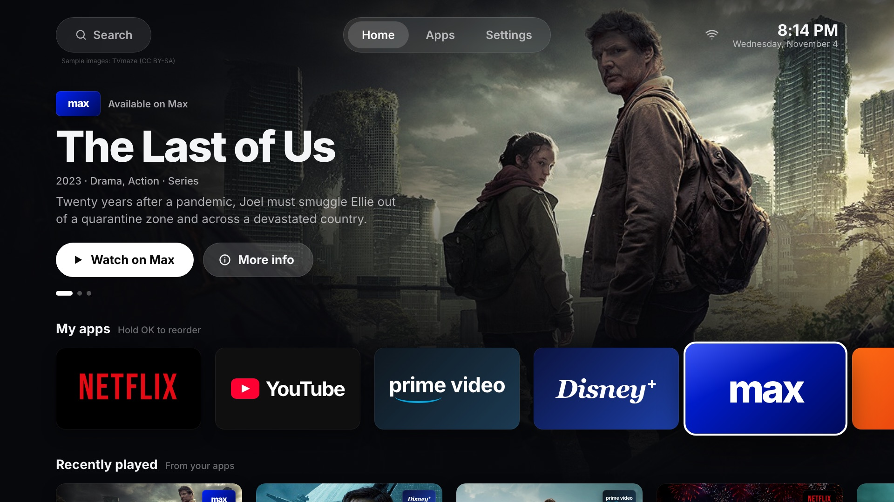
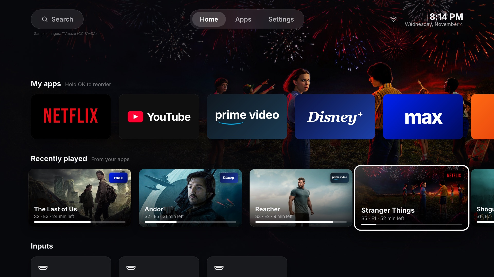
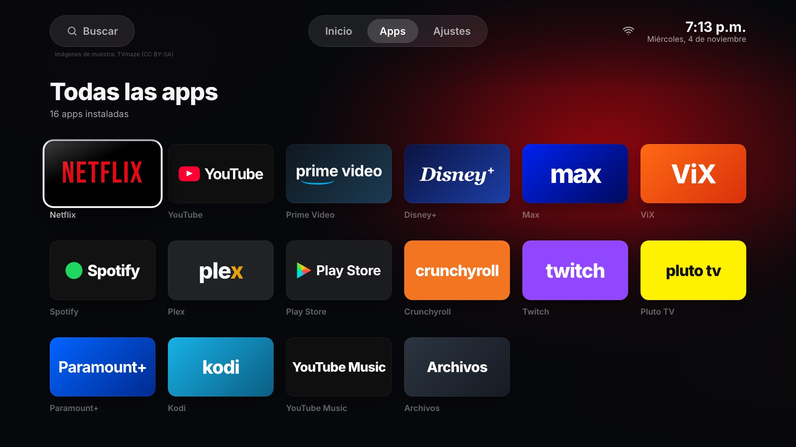
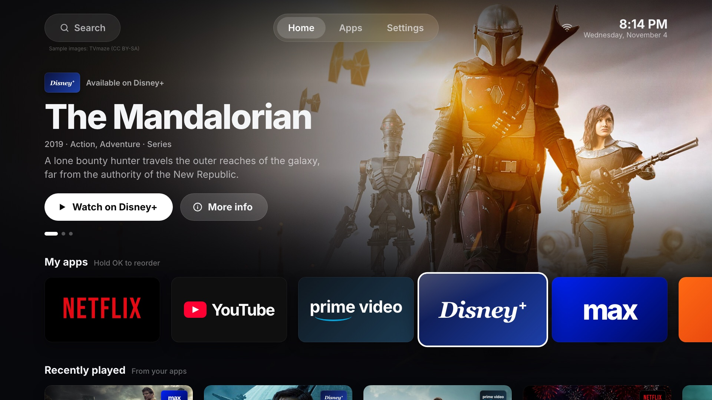
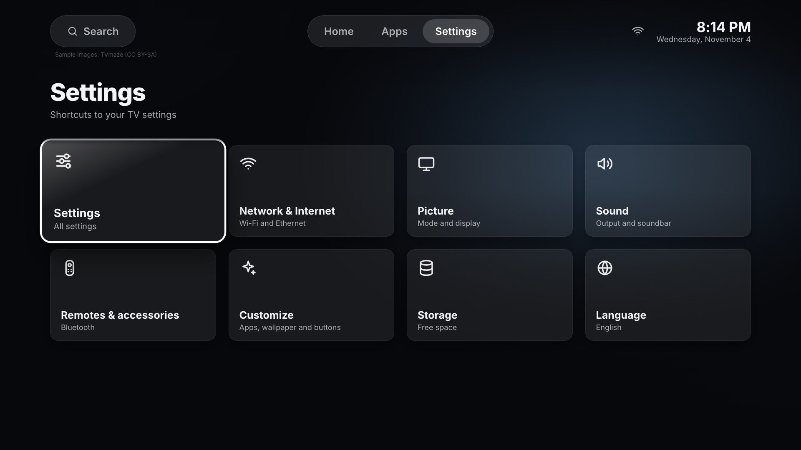

# hack_tv

**English** · [Español](README.es.md)

Custom Android TV launcher: ad-free home screen, remote button remapping, and streaming recommendations. Built with Kotlin and Compose for TV.

It started as a way to speed up and clean up a Hisense Android TV (Android 12, MediaTek MT9689, 2.4 GB RAM) without buying third-party apps.

**[▶ Try the interactive mockup](https://diegopq.github.io/hack_tv/)** ([English](https://diegopq.github.io/hack_tv/?lang=en) · [Español](https://diegopq.github.io/hack_tv/?lang=es)): use your keyboard as the remote, or click and tap.



| Recently played | All apps |
|---|---|
|  |  |
| **Recommendations from the apps you have** | **Settings shortcuts** |
|  |  |

> Screenshots come from the HTML mockup, not the Android app yet. The UI is available in English and Spanish.

## Contents

- [Status](#status)
- [Planned features](#planned-features)
- [Design mockup](#design-mockup)
  - [Languages](#languages)
  - [URL parameters](#url-parameters)
- [Build and install the launcher](#build-and-install-the-launcher)
  - [Remote buttons](#remote-buttons)
  - [Make it the home screen](#make-it-the-home-screen)
  - [Move and hide apps](#move-and-hide-apps)
  - [Recommendations](#recommendations)
  - [Clock, network and weather](#clock-network-and-weather)
  - [Inputs](#inputs)
  - [Recently played](#recently-played)
  - [New in your apps](#new-in-your-apps)
  - [Featured in your apps](#featured-in-your-apps)
- [Configuration](#configuration)
- [Enable network debugging on your TV](#enable-network-debugging-on-your-tv)
  - [Let an AI agent guide you](#let-an-ai-agent-guide-you)
- [Optimize your TV with an AI agent](#optimize-your-tv-with-an-ai-agent)
- [Revert the TV optimizations](#revert-the-tv-optimizations)
- [Credits](#credits)
- [License](#license)

## Status

| Part | Status |
|---|---|
| UI design (HTML mockup) | ✅ Done: [`diseno/maqueta.html`](diseno/maqueta.html) |
| Revert script for the TV optimizations | ✅ Done: [`revert_tv.sh`](revert_tv.sh) |
| Android launcher app | 🚧 v0.16 in [`launcher/`](launcher/): Home with the recommendations banner (TMDB; without a key it spotlights the focused app), remote shortcut buttons, your apps (move and hide them), Recently played, HDMI inputs and settings shortcuts, the All apps and Settings pages, English and Spanish |

## Planned features

- **Ad-free home screen** with your apps, HDMI inputs, and system shortcuts.
- **Recommendations banner** with movies and series available on the streaming apps you have installed, from [TMDB](https://www.themoviedb.org/). It shows a random mix from those apps only.
- **Recently played** row: the Continue watching list your apps publish for the TV, plus the launcher's own local history of what your apps play (Android media sessions), without repeats.
- **Remote button remapping** through an accessibility service, for example the Settings, App list, YouTube, Prime Video, and Disney+ buttons.
- **Lightweight**: tuned for low-end TV hardware.

## Design mockup

Try it online at **[diegopq.github.io/hack_tv](https://diegopq.github.io/hack_tv/)**, or open [`diseno/maqueta.html`](diseno/maqueta.html) locally in a browser. It renders at 1920×1080 and scales to fit the window. Every push to `diseno/` redeploys it through [GitHub Pages](.github/workflows/pages.yml).

Use the keyboard as the remote:

| Key | Action |
|---|---|
| Arrow keys | Navigate |
| Enter | Open |
| Esc | Back to home |
| ← → on the banner buttons | Previous or next recommendation |
| A / S | Simulates the remote's App list and Settings buttons |
| N / Y / P / D | Simulates the Netflix, YouTube, Prime Video, and Disney+ buttons |
| L | Switch language (English / Spanish) |
| H | Show or hide the help bar |
| Click or tap | Focus an item; click again to open it |

### Languages

The mockup supports English and Spanish. It picks the language in this order:

1. The `?lang=en` or `?lang=es` URL parameter.
2. The language you last chose with **L** or the **Language** card in Settings. It's saved in your browser.
3. Your browser's language, falling back to English.

All UI text lives in the `I18N` dictionary in [`diseno/maqueta.html`](diseno/maqueta.html). To add a language, copy the `en` block, translate it, and add the translations to the `{es:…, en:…}` fields of the sample data. The Android app will use standard Android string resources instead, and request TMDB data in the TV's language.

### URL parameters

URL parameters set a starting state, which is handy for demos and screenshots: `?lang=en`, `?app=max`, `?focus=recent&recent=2`, `?focus=hero`, `?view=apps`, `?view=settings`, `?hint=0`, `?autoplay=0`, `?still=1` (turns off animations).

The sample artwork comes from [TVmaze](https://www.tvmaze.com/) (CC BY-SA) and loads from their servers.

## Build and install the launcher

The app lives in [`launcher/`](launcher/): Kotlin and Compose for TV, Android 12 (API 31) or newer. You need a JDK 17 or newer (Android Studio's bundled one works) and the Android SDK with platform 36.

```bash
cd launcher
./gradlew assembleRelease          # builds app/build/outputs/apk/release/app-release.apk (about 2 MB)
adb connect <TV_IP>:5555
adb install -r app/build/outputs/apk/release/app-release.apk
```

Open it from the TV's app list (**hack_tv**). It's also registered as a home app, but on Google TV the stock launcher keeps the Home button until it's disabled. Turn on the remote buttons (below) before you disable it, because on Hisense TVs some shortcut buttons only work through the stock launcher.

### Remote buttons

An accessibility service, **hack_tv remote buttons**, makes the remote's shortcut buttons work without the stock launcher. It only reacts to these buttons and never reads the screen:

| Button | Key code | Opens |
|---|---|---|
| Settings (gear) | 83 | The launcher's Settings page |
| App list | 284 | The launcher's All apps page |
| YouTube | 190 | YouTube |
| Prime Video | 295 | Prime Video |
| Disney+ | 607 | Disney+ |
| Netflix | 265 | Not touched: the TV handles it |

When an app isn't installed, its button opens its Play Store page. The codes come from a Hisense remote; other remotes may send different ones (they're in [`RemoteKeys.kt`](launcher/app/src/main/java/io/github/diegopq/hacktv/keys/RemoteKeys.kt)).

Turn it on in the TV's **Settings → System → Accessibility → hack_tv remote buttons**, or over adb. Check first which services are already on, so you don't turn them off:

```bash
adb shell settings get secure enabled_accessibility_services
# null or empty: only this service
adb shell settings put secure enabled_accessibility_services io.github.diegopq.hacktv/io.github.diegopq.hacktv.keys.RemoteKeyService
# otherwise, keep the current value and add this one after a colon
adb shell settings put secure enabled_accessibility_services "<current value>:io.github.diegopq.hacktv/io.github.diegopq.hacktv.keys.RemoteKeyService"
adb shell settings put secure accessibility_enabled 1
```

Recommended: let the launcher keep the service on. Some firmware (this Hisense, in standby) wipes the accessibility settings, which turns the buttons off; with this permission the launcher notices and turns the service back on within seconds:

```bash
adb shell pm grant io.github.diegopq.hacktv android.permission.WRITE_SECURE_SETTINGS
```

The remote buttons are always on: there's no switch for them in the launcher. The same service shows the volume as a number right under the TV's own volume bar: with a soundbar over HDMI-CEC, Android TV's bar has no level, but the soundbar reports it (0 to 100) and the launcher shows it for a moment whenever it changes. The volume buttons themselves stay with the TV. Keys sent with `adb shell input keyevent` don't go through accessibility services, so test the buttons with the real remote.

### Make it the home screen

Once the remote buttons work, make hack_tv the TV's real home screen. Google TV then stops showing at power-on, and Home or Back from any app lands on hack_tv:

```bash
adb shell pm disable-user --user 0 com.google.android.apps.tv.launcherx      # Google TV's launcher
adb shell pm disable-user --user 0 com.google.android.tungsten.setupwraith   # its recovery screen would take Home otherwise
adb shell cmd package set-home-activity io.github.diegopq.hacktv/.MainActivity
```

Wait about 30 seconds before rebooting, so Android saves the change. If another launcher's accessibility service redirects Home (Projectivy does), turn it off first. Before disabling setupwraith, check that your saved Wi-Fi doesn't belong to it: `adb shell dumpsys wifi | grep -o 'cname=[^ ]*'` should show `android.uid.system`. `./revert_tv.sh` turns both packages back on.

### Move and hide apps

Hold OK on an app in **My apps** for its menu:

- **Move**: the tile gets a blue outline and ← → carry it along the row. OK or Back puts it down. The order is saved on the TV.
- **Hide from Home**: removes it from My apps. It stays on the **All apps** page, dimmed and marked *Hidden*; hold OK on it there and choose **Show on Home** to bring it back.
- **App info**: Android's page for the app (storage, permissions, uninstall).

Apps installed later go at the end of the row.

### Recommendations

With `TMDB_API_KEY` set in `.env`, the banner shows new releases on the streaming apps installed on the TV first (movies from the last two months and series that premiered in the last three, marked **New on …**), then popular movies and series from the last three years, in the TV's language, in the variant of its country (Spanish outside Spain uses TMDB's Latin American Spanish, so "Deadpool & Wolverine" rather than Spain's "Deadpool y Lobezno"). Services are detected automatically: the launcher downloads TMDB's list of streaming services for your country and matches it against the names of your installed apps, so Mercado Play, Runtime, Pluto TV or MUBI show up on their own. A short built-in list covers apps whose name differs from TMDB's (Prime Video, HBO Max). Services with a small or classic catalog fall back to their popular titles of any year. Apps without a TMDB catalog (YouTube, Spotify) don't appear. Only services whose app is installed are used, and the banner shows a random mix of up to ten titles that takes turns between them, new each time you open Home. Results are cached for six hours. The country comes from the TV's time zone (America/Mexico_City means Mexico), because the language setting often names another country (`es-US` on a TV in Mexico). Set `TMDB_REGION` only to force a different country. **More info** opens the title's own page: its logo, year, seasons or running time, age rating for your country, TMDB score, synopsis, creators or director, cast with photos and, for series, every season. **Watch on …** opens it in its app and **Trailer** plays it on YouTube; Back returns to the banner where you left it. The key is built into the APK, so don't share your APK publicly.

### Clock, network and weather

Next to the clock, an icon shows how the TV is online: Ethernet, Wi-Fi, a warning when the network doesn't reach the internet, or crossed out when offline. Under the date goes the weather now, with an icon, the temperature (°C, or °F in the United States) and a word ("Clear", "Partly cloudy", "Rain"). The TV has no GPS, so its approximate place comes from its internet connection through [ipwho.is](https://ipwho.is/) once a day, and the weather from [Open-Meteo](https://open-meteo.com/) every half hour. Neither needs an account or a key.

### Inputs

The Inputs row lists the TV's HDMI ports. Hold OK on one to say what's connected (Xbox, PlayStation, Nintendo Switch, Apple TV, Chromecast, Fire TV, cable box, PC or soundbar): the card then shows "Xbox" over "HDMI 4", with a controller icon for consoles. A name given in the TV's own input settings, or one a device announces over HDMI-CEC, shows up on its own.

### Recently played

The row under My apps shows only movies and series (no YouTube videos or music) and combines two sources, newest first:

- **Continue watching from your apps**: what apps such as YouTube or Prime Video publish for the TV, with the episode, the time left and a progress bar. OK opens it right where the app says. Apple TV, Disney+, Prime Video and Netflix publish it on a Hisense Google TV; Netflix adds a show only after you watch it.
- **Your own history**: what any app played for at least 45 seconds, as the TV's player controls report it (title, artwork and position). Trailers that start by themselves on an app's home screen don't count. OK opens the app. Anything already in Continue watching is left out, so a show never appears twice, but playing it moves its card to the front. Some apps (Netflix, Apple TV) don't report titles to the player controls, so only their Continue watching shows. It stays on the TV, in the launcher's private storage, up to 30 entries.

The row is always on, and each source needs a one-time permission. The launcher asks for Continue watching on screen the first time it opens. Android TV has no screen for the history permission, so allow it once over adb:

```bash
adb shell pm grant io.github.diegopq.hacktv android.permission.READ_TV_LISTINGS      # Continue watching (same as the on-screen prompt)
adb shell cmd notification allow_listener io.github.diegopq.hacktv/io.github.diegopq.hacktv.media.PlaybackListener   # your own history
```

Hold OK on a card and choose **Remove from the list** to hide it. Apps' Continue watching rows can only be changed by their own app, so the launcher hides the card instead, until you play it again: then it comes back to the front on its own.

The history permission is listed as notification access, but the launcher only follows the player controls and never reads notifications.

### New in your apps

This row shows new seasons of the series you watch. First come the ones the apps announce themselves: Prime Video and Apple TV mark a new season of something you watch as "new" in Continue watching, and OK opens it right there. Then the launcher adds what it finds on TMDB: it remembers every series that appears in Continue watching (with the season you reached, even after the app drops the row), finds each one on TMDB by its exact name, and checks its seasons twice a day. A card appears for a later season that premiered in the last year (**New season · S3**) or that premieres in the next three months (**S2 arrives December 1**). OK opens the app you watched it in; hold OK to remove a card. The TMDB part needs `TMDB_API_KEY`.

### Featured in your apps

Every app keeps publishing rows of titles for the TV's home screen ("preview channels") even though Google TV no longer shows them: Netflix, Prime Video, Disney+, Apple TV, Mercado Play, Runtime and others. This row shows a few from each app in turn, in the order of My apps, leaving out what the rows above already show. OK opens the title right in its app. The banner uses these links too: when the app features the recommended title, **Watch on …** opens the title instead of the app's home. They need no TMDB key, only the Continue watching permission.

There are no published APKs: everyone builds their own from the source, with their own `.env`. Release builds are signed with your local debug key, so they install over adb.

## Configuration

Local settings and API keys live in a `.env` file that Git ignores:

```bash
cp .env.example .env
```

| Variable | Description |
|---|---|
| `TV_IP` | Your TV's IP address on the local network |
| `TV_PORT` | adb port (default `5555`) |
| `TMDB_API_KEY` | Free TMDB API key for recommendations ([get one here](https://www.themoviedb.org/settings/api)). Read when the launcher is built; without it Home's banner shows the focused app (its name, banner and a glow in its color) instead of recommendations |
| `TMDB_REGION` | Optional two-letter country for streaming availability (`MX`, `US`…). Empty detects it from the TV's time zone |

Never commit `.env`. Only `.env.example` belongs in the repository.

## Enable network debugging on your TV

`adb` lets your computer, or an AI agent running on it, control the TV over Wi-Fi. Menu names change a little between brands and Android TV versions.

1. **Turn on Developer options.** Go to **Settings → System → About** (on older Android TV: **Settings → Device Preferences → About**). Select **Android TV OS build** (or **Build**) 7 times, until you see "You are now a developer".
2. **Turn on debugging.** Go back to **Settings → System → Developer options** and turn on **USB debugging**. If you also see **Network debugging** or **ADB over network**, turn it on too.
3. **Find the TV's IP address.** Go to **Settings → Network & Internet** and select your Wi-Fi network. Write the IP down, for example `192.168.1.50`, and put it in `TV_IP` in your `.env`.
4. **Install adb on your computer.** Download [Android platform-tools](https://developer.android.com/tools/releases/platform-tools), or on macOS run `brew install android-platform-tools`.
5. **Connect.** The TV and the computer must be on the same network:

   ```bash
   adb connect 192.168.1.50:5555
   ```

6. **Accept the prompt on the TV.** The TV asks *"Allow USB debugging?"*. Check **Always allow from this computer** and choose **OK**. Check that it worked:

   ```bash
   adb devices   # the TV should appear as "device", not "unauthorized"
   ```

**If `connect` fails:** some TVs use **Wireless debugging** with a pairing code instead. Open it in Developer options, choose **Pair device with pairing code**, then run `adb pair <IP>:<pairing port>` and enter the code. After that, run `adb connect <IP>:<port>` with the port shown on that screen.

**Security:** only computers you approve on the TV can connect, but turn **USB debugging** off when you're done tweaking, especially on a shared network.

### Let an AI agent guide you

If you'd rather be walked through it, paste this prompt into an AI agent that can run commands on your computer, such as [Claude Code](https://claude.com/claude-code). The agent can't press buttons on the TV, so it tells you what to select and checks each step from the computer:

```text
Help me enable adb network debugging on my Android TV so this computer can connect to it over Wi-Fi. Guide me one step at a time and wait for me to confirm each step before moving on. I'm using the TV remote, so tell me exactly which menus and options to select, and keep in mind that menu names vary by brand and Android TV version (Google TV vs. older Android TV).

1. Check this computer first: is adb (Android platform-tools) installed? If not, tell me how to install it for my operating system and verify it with "adb version".
2. Walk me through turning on Developer options on the TV (selecting the build number 7 times in About).
3. Walk me through turning on USB debugging and, if the TV has it, Network debugging / ADB over network or Wireless debugging.
4. Help me find the TV's IP address from its network settings. If I can't find it, you may look for devices on my own local network with port 5555 open, but tell me what you're going to run first.
5. Connect with "adb connect <IP>:5555". If the TV uses Wireless debugging with a pairing code instead, guide me through "adb pair" first.
6. Remind me to accept the "Allow USB debugging?" prompt on the TV and check "Always allow from this computer". Then run "adb devices" and confirm the TV shows as "device".
7. If something fails ("unauthorized", "connection refused", timeouts), explain the likely cause and how to fix it. Try restarting the adb server before anything else.
8. When it works, save the IP as TV_IP in a .env file in this folder (create it from .env.example if it exists), run "adb shell getprop ro.product.model" to show me the TV model, and remind me to turn USB debugging off when I'm done.

Don't change any setting on the TV through adb yet; this task is only about getting connected.
```

## Optimize your TV with an AI agent

You can hand the cleanup to an AI coding agent that can run commands on your computer, such as [Claude Code](https://claude.com/claude-code). First enable network debugging (previous section), then paste this prompt and replace `<TV_IP>` with your TV's IP:

```text
I want to speed up my Android TV and remove things I don't use. It's on my local network with adb network debugging enabled at <TV_IP>:5555. Use adb from this computer; if it isn't installed, tell me how to install it first.

1. Connect and analyze
   - Connect with adb and confirm the TV shows as "device". If it shows "unauthorized", ask me to accept the prompt on the TV.
   - Report the model, Android version, CPU, RAM, free storage, and what is using the most memory and CPU (dumpsys meminfo, top, load average).
   - List the installed packages and group them: system essentials, manufacturer extras, preinstalled apps, and apps I installed.

2. Propose a plan before changing anything
   - For every package you want to disable, explain in plain words what it does and what could stop working. Ask me to confirm each group, and ask which apps and features I actually use (casting/AirPlay, voice assistant, live TV tuner, manufacturer store, screensaver, etc.).
   - Don't disable the active screensaver (`settings get secure screensaver_components`, usually Google's ambient mode `com.google.android.apps.tv.dreamx`) unless you switch to another one or turn screensavers off: when Android can't start the screensaver it puts the TV to sleep right away, so it turns off after the screensaver delay instead of the sleep timer.
   - Also propose performance tweaks: shorter animations (window_animation_scale, transition_animation_scale, animator_duration_scale) and a lower background process limit (device_config activity_manager max_cached_processes).
   - Do not change anything until I approve.

3. Apply the changes safely
   - Only use reversible commands: "pm disable-user --user 0 <package>" and "settings put". Never uninstall system packages, never clear app data, and never touch Play Store, Google Play services, the system UI, input methods, or the TV's input/tuner services unless I ask.
   - Before disabling anything, write a revert script (revert_tv.sh) that re-enables every package you disable and restores the original settings, and show it to me.
   - Package changes are written to disk with a delay: wait about 30 seconds after the last change before rebooting.
   - Disable in small groups. After each group, reboot and test with me: the home screen, every button on the remote (Home, Back, Settings, app shortcut buttons, volume), HDMI inputs, sound, and my streaming apps.

4. Things that commonly break (learned on a Hisense Android TV)
   - The remote's shortcut buttons (Settings, App list, YouTube, Prime Video, Disney+) are often handled by the stock launcher or by a manufacturer service (on Hisense, com.vt.tv.smartsense). Test the buttons after disabling launcher or manufacturer packages, and re-enable what's needed.
   - Disabling the stock launcher (Google TV: com.google.android.apps.tv.launcherx) can leave a setup recovery screen as the home screen (com.google.android.tungsten.setupwraith). Don't disable the stock launcher until a replacement launcher is installed and set as home.
   - Volume lag through a soundbar on HDMI-CEC/ARC comes from the soundbar, not the TV; don't try to fix it by disabling packages.

5. Install the hack_tv launcher
   - There's no ready-made APK: build it from the source. Clone https://github.com/diegopq/hack_tv, copy .env.example to .env (ask me for my TMDB API key, or leave it empty: the launcher works without it, with no recommendations or new seasons), and follow "Build and install the launcher" in the README. It needs a JDK 17 or newer and the Android SDK (Android Studio brings both); if they aren't installed, tell me what's missing.
   - Install it with "adb install", set it as the home app, and walk me through the permissions it needs (accessibility service for the remote buttons, TV listings and notification access for "Recently played") on the TV screen. Don't enter any passwords or accounts for me.
   - Test the home screen and remote buttons with me, and add any new changes to the revert script.

At the end, give me a summary: what you changed, how much free memory there is compared to before, and how to undo everything with the revert script.
```

The prompt asks the agent to confirm before every change and to keep everything reversible. Read each step it proposes before you approve it.

## Revert the TV optimizations

The optimizations disable some preinstalled packages (Hisense extras, AirPlay, Google ambient screensaver) and speed up animations. If you disabled the ambient screensaver and the TV now turns off after about 10 minutes, turn it back on with `adb shell pm enable --user 0 com.google.android.apps.tv.dreamx`. To undo them, run this with network debugging enabled on the TV and `TV_IP` set in `.env`:

```bash
./revert_tv.sh               # re-enable everything
./revert_tv.sh com.vt.alexa  # re-enable a single package
```

Requires [Android platform-tools](https://developer.android.com/tools/releases/platform-tools) (`adb`). The script looks for it in `~/Library/Android/sdk/platform-tools/adb`. Set `ADB` to point somewhere else.

## Credits

- Recommendations data: [TMDB](https://www.themoviedb.org/). This product uses the TMDB API but is not endorsed or certified by TMDB.
- Sample images in the mockup: [TVmaze](https://www.tvmaze.com/).
- App names and logos belong to their respective owners. They aren't included in this repository; the launcher uses each installed app's own banner.

## License

[Apache License 2.0](LICENSE)
